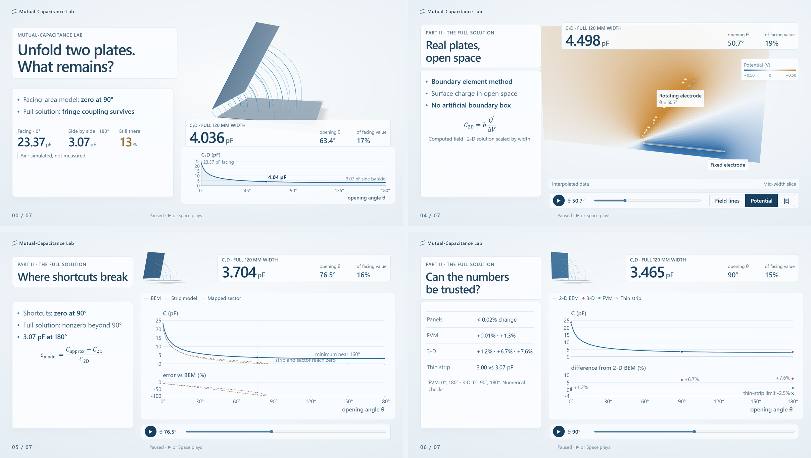

# Mutual-Capacitance Lab

Unfold two finite plates from facing to side by side: how much capacitance is left? Parallel-plate theory says none. A boundary-element solution of the real geometry gives 23.37 pF facing and 3.07 pF side by side, so 13% survives as pure fringe coupling. Eight pages; one demo of the [Capacitance Demos collection](../../README.md).



## The story

| Page | Layout | What it shows |
| --- | --- | --- |
| 00 | Cover | The question, the live unfolding and the C(θ) curve |
| 01 | Stage | One fixed hinge and pure rotation set the final gap, g = 2δ; the parameter table |
| 02 | Split | Small angles: the strip model next to the solution, 9% low even at 0° |
| 03 | Stage | An ideal sector: field lines as arcs, solved exactly |
| 04 | Stage | The boundary element method in open space; switch field lines, potential and field strength |
| 05 | Chart | The 0–180° sweep: where the strip and sector shortcuts break |
| 06 | Chart | Four independent checks: panel refinement, finite volumes, 3-D finite width, thin-strip limit |
| 07 | Closing | Three takeaways and a link to ProxiTouch, which builds a sensor on this fringe field |

Visible controls are kept to an angle slider, one view switch on the field page and Previous/Next; the model can be turned by dragging it. Keyboard shortcuts are listed under Methods.

The 2026-10-23 English edition replaced the earlier 12 slides. The partial-dielectric pages were removed: a flat slab under a rotating plate did not fit the unfolding geometry. The εr = 4 data remain in the data file for provenance but are not shown.

## Open and build

The collection entrance is the root `index.html`, or run `npm run preview` from the repository root. The generated `index.html` in this folder also opens offline; the browser needs WebGL2.

From this folder, with Node.js 22 or newer:

```sh
npm run build:offline
npm run check
npm test
```

The offline build uses the bundled TypeScript 5.8.3; `npm --prefix source ci` installs from the lock file when online. Source is in `source/src/`, styles in `source/public/`; the build regenerates `dist/`, `index.html` and the project `site/`, gathered by the collection workflow into the root `site/mutual-capacitance/`.

## What is preserved

The original upload `reference/final-upload.html` keeps its original bytes. Parameters and precomputed data (`parameters.json`, `data/results.json`, `source/src/physics/data.ts`) are unchanged and frozen by hash in the [release contract](docs/RELEASE_CONTRACT.json). Every number shown on a page is read from that data. The current page text is exported in [SCENE_COPY.md](docs/SCENE_COPY.md).

`npm test` checks the release contract, the frozen inputs and the regressions in `model-regressions.mjs`. Browser checks run from the collection root with `npm run qa`; previews refresh with `npm run previews`.

## Model scope

Values come from the Python BEM solvers and one parameter file. 2-D results are scaled by the real width; 3-D checks exist for three air angles only. Field maps and in-between angles are interpolated from precomputed data; the browser does not solve anything live, and nothing here is a measurement. See the [numerical report](docs/NUMERICAL_REPORT.md) and [REPRODUCE](docs/REPRODUCE.md).

## Archive and licence

Historical reports and old tests are in `archive/` and `source/legacy-tests/`; the earlier stand-alone deployment hand-off is in `archive/prior-github-handoff/`. Historical conclusions do not certify the current build.

Original source, text and data are under [MIT](LICENSE); KaTeX and TypeScript keep their own licences, and the stand-alone HTML and the published site carry the required notices. Publishing goes through the [collection workflow](../../.github/workflows/pages.yml).
