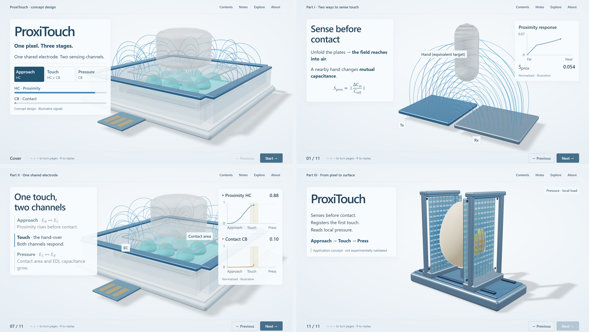

# ProxiTouch

A concept design for one capacitive pixel that follows a whole touch: it senses a finger coming, registers the first contact, then reads the press. One shared electrode hands the measurement from a fringe field in the air to an ionic interface. Twelve pages; one demo of the [Capacitance Demos collection](../../README.md).



## The story

| Pages | What they show |
| --- | --- |
| Cover | The full approach → touch → press loop, with a live stage track and both channel levels |
| 01–03 · Two ways to sense touch | A fringe field that reaches into the air; an electric double layer only nanometres thick; pressure growing the contact area |
| 04–08 · One shared electrode | The question, the shared electrode, the pixel layers, one touch read on two channels, and time-division multiplexing |
| 09–11 · From pixel to surface | A shared-frame array, a sensing surface, and an egg-grasp application concept |

The 2026-10-23 English edition merged the original 23 slides: the parallel-plate, series/parallel and composite-capacitor basics folded into the mechanism pages, and the three single-stage pages folded into "One touch, two channels", whose paragraphs light up with the animation.

## Open and build

The collection entrance is the root `index.html`, or run `npm run preview` from the repository root. The generated `index.html` in this folder also opens offline; the browser needs WebGL2.

From this folder, with Node.js 22 or newer:

```sh
npm run build:offline
npm run check
npm test
```

The offline build uses the bundled TypeScript 5.8.3; `npm --prefix source ci` installs from the lock file when online. Source is in `source/src/`, styles in `source/public/`; the build regenerates `dist/`, `index.html` and the project `site/`, which the collection workflow gathers into the root `site/proxitouch/`.

## What is preserved

The original upload `reference/final-upload.html` keeps its original bytes, including the original Chinese text. Scientific parameters and precomputed field tables are unchanged. Every built module is approved by exact hash in the [release contract](docs/RELEASE_CONTRACT.json); modules changed by the English edition are marked there. The current page text is exported in [SCENE_COPY.md](docs/SCENE_COPY.md).

`npm test` checks the release contract, the frozen scientific inputs and the behaviour regressions in `proxi-regressions.mjs`. Browser checks run from the collection root with `npm run qa`; previews refresh with `npm run previews`.

## Model scope

ProxiTouch has not been fabricated or measured. Ions, micro-domes and signals are explanatory models; the 2-D numerical fields are drawn as 3-D depth slices and are not a full 3-D finite-element validation of the device. See [physics notes](docs/PHYSICS_README.md).

## Archive and licence

Historical reports and old tests are in `archive/` and `source/legacy-tests/`; the earlier stand-alone deployment hand-off is in `archive/prior-github-handoff/`. Historical conclusions do not certify the current build.

Original source, text and data are under [MIT](LICENSE); KaTeX and TypeScript keep their own licences, and the stand-alone HTML and the published site carry the required notices. Publishing goes through the [collection workflow](../../.github/workflows/pages.yml).
